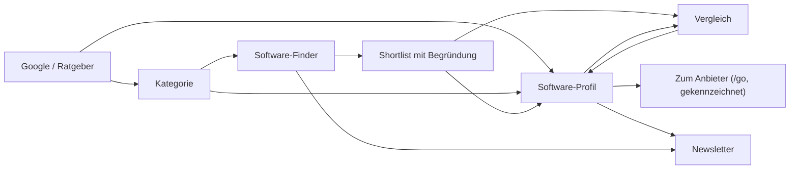
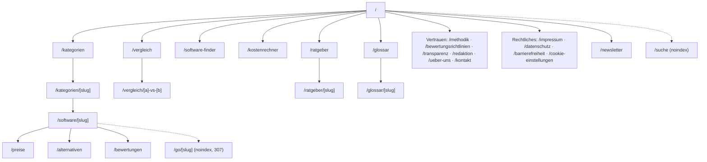

# Plan

## Mission

Stackwahl helps businesses in Germany choose cloud business software with confidence. Every page helps answer one question: "Welche Software passt wirklich zu meinem Unternehmen, und was kostet sie mich?" The audience is founders, freelancers, small and medium businesses, office managers and accountants who are deciding which tool to try or buy.

The site answers with independent, sourced reviews, a transparent score, German compliance checks (GoBD, E-Rechnung, DATEV, ELSTER, server location) and a Software-Finder that turns requirements into a short, explained shortlist. It earns money through clearly labeled affiliate links that never influence scores, rankings or Finder results.

It beats the existing portals (OMR Reviews, Capterra, SoftwareAdvice, Appvizer, SoftwareSuggest) by being calmer, faster and more German-specific. That means:

- no lead-form traps and no self-awarded badges
- no invented numbers
- a visible date and source on every price and fact
- one clear next step per page

Every later decision is checked against this mission.

---

## Phase 0: Foundation (status: approved 24.10.2026)

1. Latest stable stack, verified live on 24.10.2026 (versions and exceptions in `DECISIONS.md`).
2. Strict TypeScript, ESLint, Prettier, Vitest, Playwright with axe, GitHub Actions CI.
3. Design tokens (Section 13.3 to 13.5) as Tailwind theme with the default palette, fonts, type scale and shadows removed.
4. Self hosted Google Sans Flex and Inter through `next/font/local`.
5. Preflight copied without system font stacks; `check:css` fails on any other font, color or gradient.
6. `site.config.ts` with Zod validation and `pnpm placeholders`.
7. One URL builder (`src/lib/routes.ts`) with German slugs.
8. `noindex` on every page and `robots.txt` disallowing everything until launch.
9. Docs files and this information architecture proposal.

---

## Phase 1: Design system (status: approved 24.10.2026, wordmark option B)

The 21st.dev MCP server is not connected (no API key), so the components are built on Radix primitives and restyled to Section 13. Every component and state goes on `/intern/styleguide` (noindex, disallowed in robots, outside the public shell) with labeled fictitious demo data.

1. Formatting helpers for euro, dates and scores (de-DE), with unit tests.
2. Primitives: Container, Panel, split Button (primary, dark, outline; link and button), Eyebrow, Headline with muted tail, TextLink, DisclosureLabel ("Affiliate-Link", "Anzeige"), Input, Select, Checkbox, Switch, SegmentedControl, Tag.
3. Signature components (13.6): FeatureTiles with line illustrations, SoftwareCard, ScoreDisplay, ProsCons, ComplianceChecklist, ProfileHeader with sticky in-page TabBar, PriceTable, ComparisonTable with "Unterschiede hervorheben", StepCards, VerdictCard, GuideCards, Marquee, LogoRow, NewsletterPanel.
4. Shell: SiteHeader with mega menu and mobile menu, SiteFooter with giant wordmark, CommandPalette (`Strg K`).
5. Three wordmark options for Stackwahl, contrast table, and the token overview.
6. E2E: axe clean on the styleguide at both widths, keyboard checks for the menus, palette, segmented control and comparison switch.

---

## Phase 2: Content layer (status: done, waiting for approval)

1. Zod schemas for vendors, categories, software (plans, sourced facts, compliance, features), ratings with a mandatory documented test, authors, comparisons, affiliate links and guides (`src/content/schemas.ts`).
2. Content Collections reads `/content` (YAML, later MDX). `pnpm content:validate` turns every collector, schema and skip event into a failure, then runs the build guards.
3. Build guards (`src/content/guards.ts`), each proven by a unit test: duplicate slugs, unresolved references, future dates (UTC), stale prices (90 days) and facts (180 days), copy rules, test claims without a test, unverified or authorless published profiles, unexplained limited availability.
4. Copy lint over the TypeScript AST and YAML (`pnpm lint:copy`), sharing its rules with the guards.
5. Search index built at build time (`src/generated/search-index.json`).
6. Data access layer (`src/lib/content`): pages will call `getSoftware(slug)`, `getLiveCategories()` and similar functions.
7. First batch: 10 researched drafts with sources (docs/CONTENT_STATUS.md). QuickBooks and FreshBooks were left out, and Odoo is deferred.

---

## Information architecture (approved by the owner on 24.10.2026, including the score weights)

### Page types

| #   | Page type          | URL                                                                        | Question it answers                                                          | Indexed                    |
| --- | ------------------ | -------------------------------------------------------------------------- | ---------------------------------------------------------------------------- | -------------------------- |
| 1   | Home               | `/`                                                                        | Where do I start and what can Stackwahl do for me?                           | yes                        |
| 2   | Category hub       | `/kategorien`                                                              | Which software categories are covered?                                       | yes                        |
| 3   | Category page      | `/kategorien/[slug]` (e.g. `buchhaltungssoftware`)                         | Which tools in this category fit which business, and why in this order?      | yes                        |
| 4   | Software profile   | `/software/[slug]` (e.g. `sevdesk`)                                        | Is this tool right for me? Verdict, features, prices, pros, cons, compliance | yes                        |
| 5   | Pricing page       | `/software/[slug]/preise`                                                  | What does it really cost me per year, net and gross?                         | yes                        |
| 6   | Alternatives       | `/software/[slug]/alternativen`                                            | What else should I consider instead, and for which reason?                   | yes                        |
| 7   | User reviews       | `/software/[slug]/bewertungen`                                             | What do verified users say?                                                  | yes, from 5 reviews        |
| 8   | Comparison page    | `/vergleich/[a]-vs-[b]`                                                    | Which of these two fits me better?                                           | only real demand pairs     |
| 9   | Comparison tool    | `/vergleich`                                                               | Compare any two or three tools side by side                                  | tool page yes, states no   |
| 10  | Software-Finder    | `/software-finder`                                                         | Which tool fits my requirements?                                             | start page yes, results no |
| 11  | Cost calculator    | `/kostenrechner`                                                           | What will my setup cost over 12 and 36 months?                               | yes                        |
| 12  | Guides hub         | `/ratgeber`                                                                | What should I know before choosing?                                          | yes                        |
| 13  | Guide article      | `/ratgeber/[slug]`                                                         | One central question per article (e.g. E-Rechnung-Pflicht)                   | yes                        |
| 14  | Glossary           | `/glossar`, `/glossar/[slug]`                                              | What does GoBD, XRechnung, EÜR mean?                                         | yes                        |
| 15  | Write a review     | `/bewertung-schreiben`                                                     | How can I share my experience?                                               | yes                        |
| 16  | Methodology        | `/methodik`                                                                | How are scores and rankings calculated? (§ 5b Abs. 2 UWG)                    | yes                        |
| 17  | Review policy      | `/bewertungsrichtlinien`                                                   | How are user reviews checked? (§ 5b Abs. 3 UWG)                              | yes                        |
| 18  | Transparency       | `/transparenz`                                                             | How is Stackwahl financed, who are the partners?                             | yes                        |
| 19  | Editorial team     | `/redaktion`, `/redaktion/[slug]`                                          | Who writes and checks the content?                                           | yes                        |
| 20  | About, contact     | `/ueber-uns`, `/kontakt`                                                   | Who is behind Stackwahl, how do I reach them?                                | yes                        |
| 21  | Newsletter         | `/newsletter`, `/newsletter/bestaetigen`                                   | Subscribe and confirm (double opt in)                                        | first yes, second no       |
| 22  | Legal              | `/impressum`, `/datenschutz`, `/barrierefreiheit`, `/cookie-einstellungen` | Legal duties                                                                 | yes, settings no           |
| 23  | Search             | `/suche`                                                                   | Find any tool, category, guide                                               | no                         |
| 24  | Affiliate redirect | `/go/[slug]`                                                               | Internal redirect to the vendor (307)                                        | no, disallowed             |
| 25  | Styleguide         | `/intern/styleguide`                                                       | Internal component review                                                    | no, disallowed             |

URL rules: German slugs, lowercase, no trailing slash, umlauts transliterated (`ue`, `oe`, `ae`, `ss`), one canonical URL per page, every link built by `src/lib/routes.ts`.

### Navigation

| Place  | Content                                                                                                                                                                                             | Why                                                                                                                                    |
| ------ | --------------------------------------------------------------------------------------------------------------------------------------------------------------------------------------------------- | -------------------------------------------------------------------------------------------------------------------------------------- |
| Header | Wordmark · Kategorien (mega menu, live categories only) · Vergleich · Software-Finder · Ratgeber · Search (`Strg K` / `⌘ K`) · one primary button "Software finden"                                 | Four routes cover all intents: browse, compare, get a recommendation, learn. One primary action, unlike the competitors' five buttons. |
| Footer | Mission line · Kategorien · Werkzeuge (Finder, Vergleich, Kostenrechner) · Über Stackwahl (Methodik, Bewertungsrichtlinien, Transparenz, Redaktion, Über uns, Kontakt) · legal row · giant wordmark | Trust pages are always one click away. This is required for UWG transparency and builds credibility.                                   |
| Mobile | Full screen menu with search first, then categories as a list, then the tools. A sticky bottom "Software finden" bar only on category and profile pages.                                            | Most mobile visitors arrive from search on a profile and need one next step.                                                           |

### Software profile structure

Built from the competitor references, but cleaner:

1. Breadcrumbs.
2. Profile header: logo, name, vendor, editorial score with one decimal, "ab … € / Monat zzgl. MwSt." with the price date, and one primary action "Zum Anbieter" (labeled as an affiliate link when it is one).
3. Sticky tab bar (in-page navigation with scroll spy): Überblick · Funktionen · Preise · Vor- und Nachteile · Rechtssicherheit · Alternativen · Bewertungen.
4. Fazit der Redaktion: a card overlapping a real author photo.
5. Score breakdown, then features, then the price table with sources.
6. Pros and cons in two columns.
7. Compliance checklist: GoBD, E-Rechnung, DATEV, ELSTER, server location, AVV.
8. Alternatives.
9. Verified reviews, then FAQ.
10. Sidebar (desktop): key facts, then alternatives. No lead form.

### Categories and launch order

| Order | Category             | Slug                   | Launch condition             |
| ----- | -------------------- | ---------------------- | ---------------------------- |
| 1     | Buchhaltungssoftware | `buchhaltungssoftware` | at least 5 verified profiles |
| 2     | Rechnungsprogramme   | `rechnungsprogramme`   | at least 5 verified profiles |
| 3     | ERP-Software         | `erp-software`         | at least 5 verified profiles |
| 4     | CRM-Software         | `crm-software`         | at least 5 verified profiles |
| 5     | Warenwirtschaft      | `warenwirtschaft`      | at least 5 verified profiles |
| 6     | Lohnabrechnung       | `lohnabrechnung`       | at least 5 verified profiles |
| 7     | Projektmanagement    | `projektmanagement`    | at least 5 verified profiles |

First content batch (Phase 2): sevdesk, Lexware Office, BuchhaltungsButler, FastBill, orgaMAX, WISO MeinBüro, Sage (German cloud products), Odoo (Buchhaltung), QuickBooks and FreshBooks. QuickBooks and FreshBooks are included only after their German availability and their suitability (GoBD, DATEV, E-Rechnung) have been verified.

### Conversion path

The primary conversion is "Zum Anbieter" through the affiliate redirect. Secondary conversions are a completed Finder and a newsletter subscription. A consultation request comes later, behind a feature flag, once the owner names a partner.

### Sitemap

### Trust pages required in Germany

Impressum (§ 5 DDG, § 18 Abs. 2 MStV), Datenschutzerklärung (DSGVO), Cookie-Einstellungen (§ 25 TDDDG), Methodik (§ 5b Abs. 2 UWG), Bewertungsrichtlinien (§ 5b Abs. 3 UWG), Transparenz (§ 5a Abs. 4 UWG), Redaktion, Erklärung zur Barrierefreiheit. A lawyer must review all legal texts before launch.

### Proposed score

Name: `{{SCORE_NAME}}` (proposal: "Stackwahl-Wertung"). Scale 0,0 to 10,0 with one decimal.

| Criterion                                                         | Weight |
| ----------------------------------------------------------------- | ------ |
| Funktionsumfang                                                   | 25 %   |
| Bedienung                                                         | 20 %   |
| Preis-Leistung                                                    | 20 %   |
| Rechtssicherheit in Deutschland (GoBD, E-Rechnung, DATEV, ELSTER) | 20 %   |
| Support und Datenschutz (Serverstandort, AVV, deutscher Support)  | 15 %   |

The owner approves or changes the weights.
